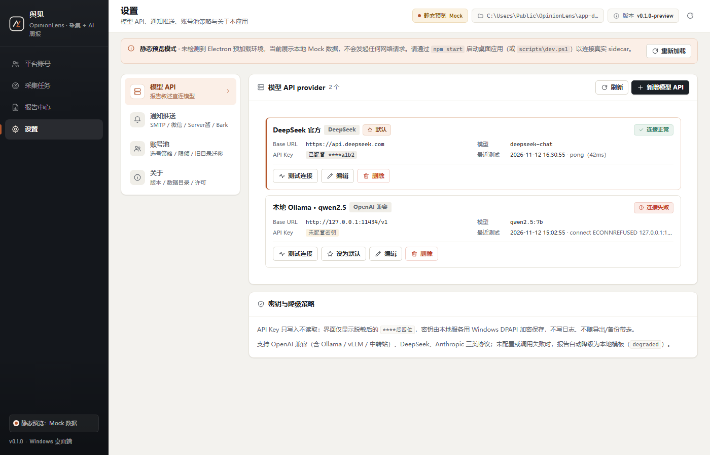

# AGENTS.md · 舆见 OpinionLens（仓库级 Agent 约定）

本文件给在本仓库工作的 AI Agent（DSH / Claude Code 等）使用，与 `README.md`（产品说明）、
`app/README.md`（应用与接口说明）、`app/CONTRACT.md`（事件/API 契约）互补；改动以这些文档为准。

## 1. 回复里的图片与文件引用（重要，曾出过问题）

- **图片一律用「工作区相对路径」，不要以 `/` 开头，也不要写绝对路径**（示例文件名）：

  ```text
  ✅ 
  ❌ 
  ```

  原因：DSH 聊天里，相对路径按「当前会话工作区」解析；`/` 开头的路径会被当作文件系统绝对路径
  （Windows 上会解析成 `E:\docs\...` 这类不存在的路径），图片加载失败时聊天里显示
  `图片无法预览 · <图片说明>`。若用户反馈「图片无法预览」，先检查图片链接是否以 `/` 开头。

- 交付图片/文档时同时调用 `present` 展示文件卡片，方便用户在侧栏打开预览。
- 引用代码位置用仓库相对路径 + 行号，例如 `app/desktop/renderer/tasks.js:417`。

## 2. 常用命令（Windows / PowerShell 7）

- 离线自测：`.\app\scripts\selftest.ps1`（实现位于 `tests/python/selftest.py`）
- 开发启动：`.\app\scripts\dev.ps1`
- 单独启动 sidecar（调试）：`.\app\scripts\run_sidecar.ps1`
- 打包资源（便携 Python/Node、sidecar、engine、MediaCrawler，报告管线存在时一并打包）：
  `.\app\scripts\build_pack_resources.ps1`
- 构建安装包：`.\app\scripts\build_installer.ps1 -SkipResources`
- 完整命令清单见 `docs/常用命令_构建运行自测.md`。

- 测试 / 替身 / 工具脚本在 `tests/`（`python/`、`fixtures/`、`tools/`、`js/`），
  **不要**再放回 `app/engine/` 或 `app/sidecar/`；新增测试时同步 `tests/README.md` 的清单。

## 3. 产物与提交

- 不要提交或清理用户运行期数据：`app/data/`、`build/`、`app/sidecar/_fixtures/*`（说明文件除外）、
  `*.exe`、`*.zip`（见 `.gitignore`）。
- 用户实测截图放 `docs/preview/`，命名沿用 `NN_描述.png`（如 `77_settings_model_api.png`）；
  UI 改动后应更新对应截图。
- 不提交任何真实平台账号、Cookie、API Key 或含个人信息的采集数据；密钥使用 Windows DPAPI 加密存储，
  禁止明文写库/写日志。

## 4. 用户环境

- 安装版数据目录：`%APPDATA%\OpinionLens`（登录态 / SQLite / 导出 Excel / 报告 / 日志，
  与安装路径无关，C 盘 D 盘或便携版都一样）。
- 开发/源码运行：数据目录为仓库内 `app/data/`（已 gitignore）。
- AI 报告：可选能力。未配置模型 API 或调用失败时报告自动使用本地模板生成（`degraded`），
  不影响采集与导出；多 LLM 模型 API 在「设置 → 模型 API」中配置。

## 5. 工程约定

- 采集引擎零侵入：对 MediaCrawler 的所有适配都写在 `app/engine/patches.py` 运行时 patch，
  **不要修改 `MediaCrawler/` 源码**。
- 事件协议与 Sidecar API 字段名以 `app/CONTRACT.md` 为准，上下游已对齐；变更需同步文档与自测。
- 前端为纯原生 HTML/CSS/JS：不引入构建框架、CDN 或外部网络资源（除 `127.0.0.1` 的 sidecar）。
- 改完代码优先跑离线自测与语法检查（`python -m compileall`、`node --check`），再交付。
